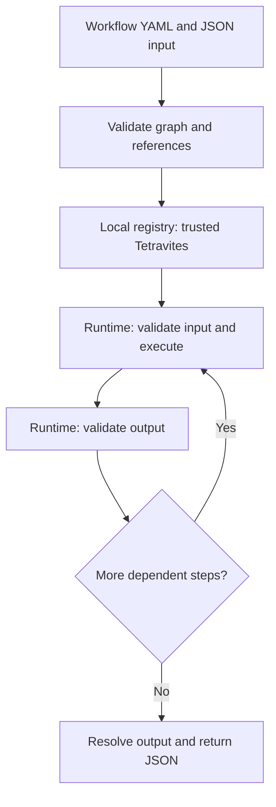

# TETRAVITE Orchestrator v0.1.0

 

**A deterministic, contract-driven workflow orchestrator for trusted Tetravite packages.** Compatible with the proposed `tetravite.dev/v1alpha1` Tool manifests through the existing `tetravite-runtime` reference executor.

## TETRA — four pillars

1. **Contract:** a Tetravite declares its input/output JSON Schemas and manifest.
2. **Execution:** the runtime executes the declared entrypoint in a subprocess.
3. **Trust:** schemas and tests validate interfaces; actual OS sandboxing must be supplied externally.
4. **Composition:** this orchestrator connects typed outputs to the inputs of later steps.

A Tetravite is **not a model**, not a prompt, and not necessarily an AI agent. It is a packaged capability with an executable contract. The **orchestrator** is not an AI model either: it runs a predefined dependency graph and coordinates capabilities. AI planning, LLM routing, and autonomous decisions are **not implemented**.

## Architecture



## Installation

Python 3.11+. From sibling folders (after extracting the previously created runtime ZIP):

```bash
python -m pip install -e ../tetravite-runtime
python -m pip install -e .
python -m unittest discover -s tests -v
```

The runtime package is a **local prerequisite**, not bundled into this repository. Install any dependencies required by each Tetravite separately.

## Run the included two-step example

The registry example points to the `hello-tetravite` included in the sibling runtime repository. From the root of `tetravite-orchestrator`:

```bash
# Inspect execution order without running code:
tetravite-orchestrator run examples/workflow.yaml --registry examples/registry.example.json --dry-run

# Execute trusted local code:
tetravite-orchestrator run examples/workflow.yaml --registry examples/registry.example.json --input examples/input.json --allow-execution
```

Expected result contains `firstGreeting: "Hello, Ada"` and `chainedGreeting: "Hello, Hello, Ada"`.

## Real integration: SEO auditor

Map a registry alias to the previously created `seo-technical-auditor-1.0.0` folder or ZIP and create a workflow step with `uses: seo-auditor` and `with: {url: "${input.url}"}`. Its HTTP behavior needs internet access, installed dependencies, and network egress controls. The included test suite deliberately avoids external HTTP.

## Repository

```text
tetravite-orchestrator/
├── src/tetravite_orchestrator/{core.py,cli.py,__main__.py}
├── examples/{workflow.yaml,registry.example.json,input.json,schemas/input.json}
├── tests/test_orchestrator.py
├── docs/{workflow-format.md,security.md}
├── .github/workflows/ci.yml
├── pyproject.toml
├── requirements.lock
└── LICENSE
```

## What this does / does not do

**Implemented:** static multi-step DAGs, local package registry, reference substitution preserving JSON types, dependency ordering, workflow input schema validation, delegated per-step input/output schema validation, subprocess execution via runtime, timeouts and structured failure reporting, CLI dry-run.

**Not implemented:** LLM/AI planning, automatic tool discovery, parallel scheduling, retries, conditional branches, state persistence, distributed workers, secrets management, authentication, OS isolation, resource quotas, audit storage, or an HTTP API.

**Security:** only execute explicitly trusted local packages. `--allow-execution` does not sandbox code. See [security notes](docs/security.md).

This is an experimental, MIT-licensed reference PoC, **not** a production-grade or certified orchestration platform. `tetravite.dev` is an illustrative API namespace, not a claim of ownership of the domain or a ratified standard.
